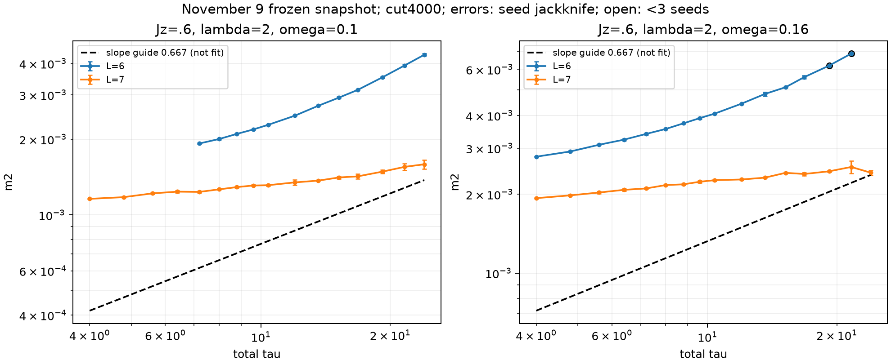
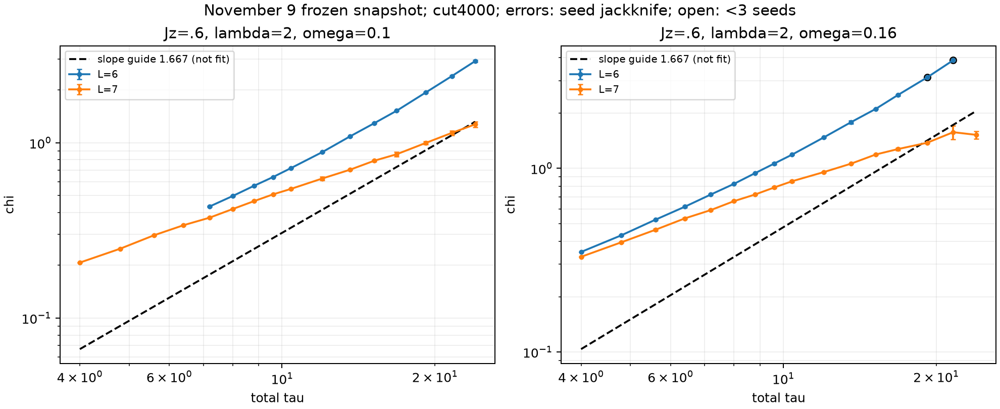
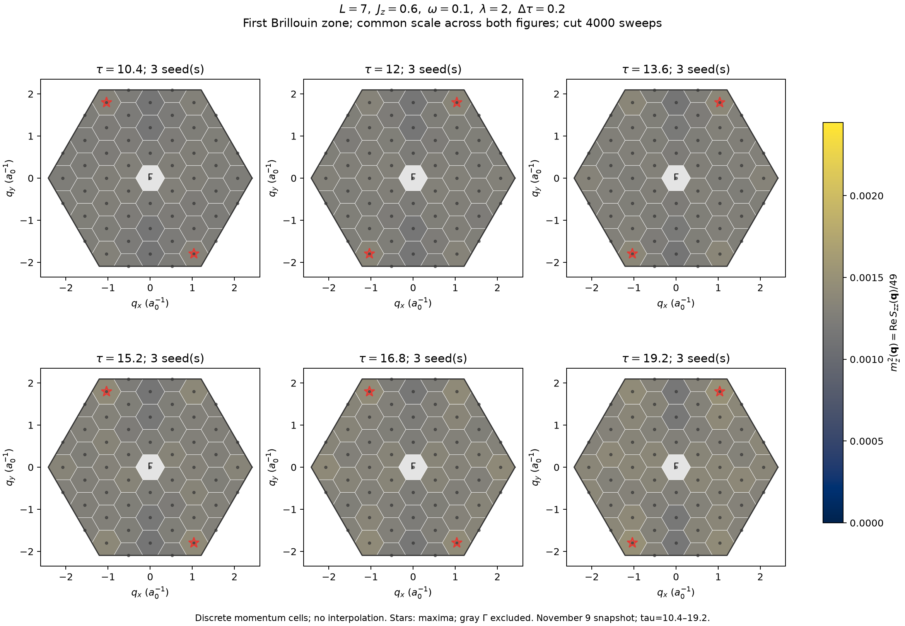
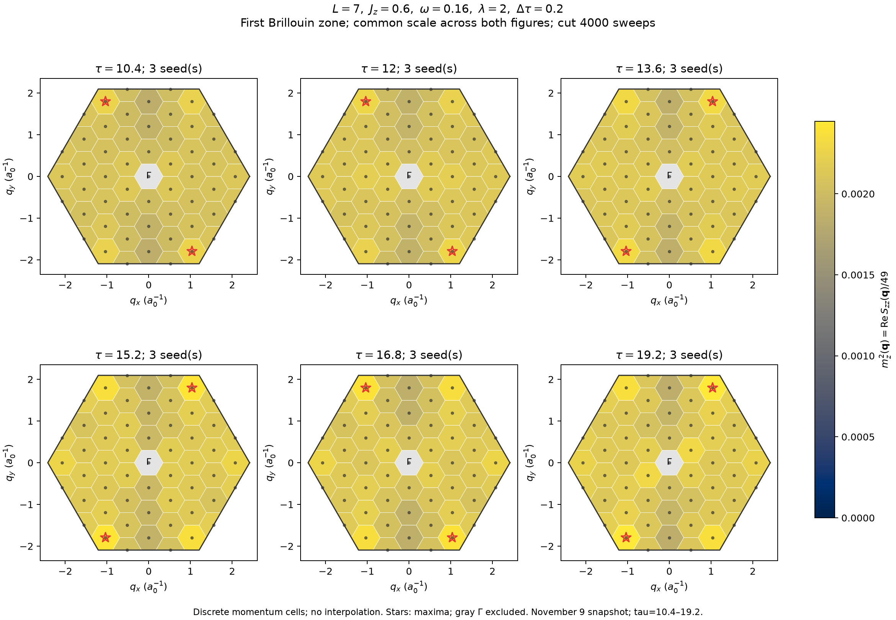

# L6 与 L7 短虚时间增长差异及交接分析

日期：2026-11-09，Asia/Shanghai。供 GPT 独立分析的冻结资料包。问题是：在 Jz=0.6、λ=2 时，为什么 L7 的 m² 和 χ 增长明显慢于预期的 2/3 和 5/3，而 L6 在部分窗口比较接近？

**当前结论：增长差异已确认；规则背景、有限低能壳层、物理 trial 与临界交叉区均有具体证据值得检查，但尚未确定主因。L6 接近理论斜率不等于已经成功提取普适指数。**

建议先读本页，再将 [GPT 分析问题](GPT_ANALYSIS_PROMPT.md)、[匹配窗口拟合](derived/matched-window-fits.csv)、[背景参考表](derived/bare-background-reference.csv) 交给分析模型。所有关键数字均可离线重算。

## 1. 数据范围与实际计算

| 项目 | 约定 |
|---|---|
| 模型 | SSH–Kitaev 声子耦合 Majorana 投影；J=(1,1,0.6)，k=1，g=√2，λ=g²/k=2 |
| 尺寸 | Lx=Ly=L；原胞 Nc=L²，matter 格点 2L²，实键场 3L² |
| 扇区 | shear=0，零通量、Wilson=(+,+)，physical matter trial |
| 频率 | ω=0.1 或0.16，m=1/ω²；不同 ω 不合并 |
| 时间 | τ=intervals×Δτ 为总开放轮廓长度，中心距 trial 为 Θ=τ/2 |
| 本包范围 | τ≤24 的59个参数点、174条选定独立 seed 链；不是完整生产扫描 |
| Δτ | L6/ω=0.1 为0.4；L6/ω=0.16、L7 两频率均为0.2 |
| 样本 | 生产目标每链30,000 measurement sweeps，warmup=0；分析舍弃前4000 measurement sweeps |
| 独立性 | 同 seed 的迁移、完整续跑只取冻结时 saved 最多的版本，不叠加祖先；配置重新启动片段未并作独立 seed |
| 完成度 | 中途统计，部分链未跑满；59点内也保留少于3 seed 的点并标记，拟合只用3 seed、相位通过判据的匹配点 |

[逐点参考结果](data/reference-results.csv) 保存 seeds、retained、saved_min/max、相位及误差。两台 HPC 的冻结索引时间约为03:59和04:05 UTC，归约完成时间不同，且主机时钟不同，不是同时快照；身份见 [快照记录](provenance/snapshot-metadata.json)。本资料包没有再次读取大型观测文件，没有新增或操作 QMC。

physical trial 只在初始化时选取满足该固定规范几何所需 matter 宇称的 Gaussian 态；它不是完整全自旋投影，也不保证相互作用基态重叠或当前 Wilson 扇区的全局最优性。

## 2. m² 和 χ 到底是什么

实键场 X_z 的复 Fourier 模式为

\[
D_z(q,t)=N_c^{-1}\sum_r e^{-iq\cdot r}X_z(r,t),\quad
S_{zz}(q)=N_c\langle |D_z(q,\tau/2)|^2\rangle.
\]

这里的“m²”是 z 键声子结构因子除以 Nc，**不是物理自旋 S_z 的关联，也不是三键临界场的完整投影**：

\[
m^2(\tau)=\max_{q\ne0}\operatorname{Re}S_{zz}(q)/N_c.
\]

χ 是中心 D 对施加在整条投影路径上的静态源的响应，trial 端点随源固定：

\[
\chi(\tau)=\max_{q\ne0}\operatorname{Re}
\big[\langle N_c D_z(q)I_z(q)^*\rangle
-N_c\langle D_z(q)\rangle\langle I_z(q)^*\rangle\big].
\]

I 使用精确 Mehler 核导数权重：c=tanh(ωΔτ/2)/ω，端点 c、内部2c。所有期望先合并不同 seed 的复相位原始矩，再除以共同复相位分母，最后做连接减法。m² 与 χ 独立在所有非零 q 上选峰，不能假定总选到同一 q。不是逐构型选峰再平均。

误差采用删整条 seed 的 jackknife，每次重选峰。单 seed 误差为空；相位判据为 |mean phase real|>5×其 seed SE。该判据不认证热化、混合或投影收敛。定义权威见 [ADR-009](../../docs/decisions/ADR-009-vbs-static-response.md) 与 [物理约定](../../docs/PHYSICS_CONVENTIONS.md)。

## 3. 斜率比较和 L6 的证据边界

以下是 ln y=a+p ln τ 的加权拟合，权重 (y/SE)²。每种 ω 下 L6/L7 使用完全相同的 τ 点、每点3 seed，并通过相位判据。

| ω | 实际 τ 点 | L | m² 有效斜率 | χ 有效斜率 |
|---|---|---|---|---|
| 0.1 | 10.4,12,13.6,15.2,16.8,19.2 | 6 | 0.6777±0.0085 | 1.5865±0.0074 |
| 0.1 | 同上 | 7 | 0.1758±0.0202 | 0.9763±0.0236 |
| 0.16 | 10.4,12,13.6,15.2,16.8 | 6 | 0.6199±0.0141 | 1.5201±0.0141 |
| 0.16 | 同上 | 7 | 0.1478±0.0218 | 0.8740±0.0291 |

误差只是测量误差的线性传播，没有包含选窗、曲率、初态或混合系统误差。尤其 L6/ω=0.1，上述 m²、χ 的 χ²/dof 分别约6.50、10.89；扩大到10.4–24，斜率变为0.7137、1.6170，而 χ²/dof 增至13.62、17.72。因此不能把小拟合误差当作已测准临界指数。

[完整拟合表](derived/matched-window-fits.csv) 同时保存不加权斜率和实际点集。L6/ω=0.16 的19.2及以后部分点不足3 seed，所以没有偷偷纳入匹配拟合。图中仍显示这些点以便审查。





虚线分别为2/3、5/3参考，不是拟合。当前没有证明 λ=2 是共同临界耦合、两尺寸存在同一标度窗口，或当前 z 键通道已经干净地选出了临界三键复场。

## 4. 规则背景有多大

### 4.1 可计算的自由参考，不是已经测出的真实背景占比

对于 k=1、固定自由声子真空 trial，独立振子的每个 q 具有

\[
m^2_{\rm free}=\frac{\omega}{2kN_c}.
\]

下表的百分数严格定义为 **自由参考值/m² 总量**。它衡量参考量级，不能解释为已经分离出的真实非临界背景比例。

| L | ω | 自由 m² 参考 | τ=10.4：总 m²；参考/总量 | τ=19.2：总 m²；参考/总量 |
|---|---|---|---|---|
| 6 | 0.1 | 0.00138889 | 0.00228025；60.9% | 0.00352566；39.4% |
| 7 | 0.1 | 0.00102041 | 0.00131301；77.7% | 0.00148696；68.6% |
| 6 | 0.16 | 0.00222222 | 0.00406375；54.7% | 0.00620187；35.8%* |
| 7 | 0.16 | 0.00163265 | 0.00226385；72.1% | 0.00244745；66.7% |

*L6/ω=0.16、τ=19.2 只有2个有效 seed，仅作参考，未用于上面的3 seed 拟合。

L7 的总量更接近这个规则涨落参考。若在某窗口确有 m²=B+Aτ^p、B>0 近似常数，则

\[
\frac{d\ln m^2}{d\ln\tau}=p\frac{A\tau^p}{B+A\tau^p}<p.
\]

**这是压低总量斜率的具体机制，但还不是对当前相互作用数据的唯一分解。** 相互作用会改变同点方差和短程关联，B 也可能随 τ 变。机械扣除自由数值、选择背景直到拟合出2/3，都不能证明临界性。本包非零 q 原始矩不能独立重建包含 Γ 的完整同点方差分解。

### 4.2 χ 的规则部分与时间尺度

同样的自由参考给出

\[
\chi_{\rm free}(\tau)=\frac{1-e^{-\omega\tau/2}}{k}.
\]

它从早期近似线性增长逐渐饱和；斜率为 x/(e^x−1)，x=ωτ/2。因此即便没有临界性，χ 也有随 τ 增长的规则部分，不能简单写成 χ=τNc m²。

L7/ω=0.1 在10.4→19.2，χ_free/χ 从74.4%降至61.8%；ω=0.16 从66.5%降至57.0%。这些也只是自由参考比例。

实测 R=χ/(τNc m²) 在 L7/ω=0.1 从0.814降至0.714，ω=0.16 从0.736降至0.598。它没有成为常数；而且这里 m²/χ 是各自选峰，R 不是同一固定 q 的严格关联时间。不能仅由 m² 的斜率加1预测当前 χ 的斜率。

τ=10–20 对应单侧传播 Θ=5–10；声子时间尺度1/ω分别为10、6.25，没有明显尺度分离。这支持微观暂态/交叉修正值得检查，但不证明 τ≫1/ω 是所有临界标度的硬性必要条件。

## 5. 低能壳层与物理 trial 不同

以下全部是 **X=0 裸自由谱**，不是相互作用物理多体能隙。Bloch 函数

\[
f(n_1,n_2)=0.6+e^{-2\pi in_1/L}+e^{-2\pi in_2/L},\quad
\epsilon_{\rm qp}=2|f|.
\]

| 项目 | L6 | L7 |
|---|---|---|
| 原胞数 | 36 | 49 |
| 自由真空代码宇称 | −1 | −1 |
| 固定规范要求代码宇称 | +1 | −1 |
| physical trial | 占据一个最低能准粒子，默认(2,4)/6 | 自由真空已相容，不阻塞 |
| 最低裸单准粒子能量 | 0.800000 | 0.309916 |
| 最低模式 | (2,4)、(4,2) | (2,5)、(5,2) |
| 占据修正总能量 | +0.800000 | 0 |
| 最低模式之间动量差 | (2,4)、(4,2)，模6 | (3,4)、(4,3)，模7 |

[裸谱可复算结果](derived/bare-shells.json)；[L7 目标端 trial 验证](provenance/L7-trial-verification.json)。L6 required parity 来自固定规范几何公式，不是为了得到期望指数而选择；继续投影不会跨越守恒的错误宇称扇区。不能通过给 L7 强行套用 L6 宇称来作“相同初态”生产对照。

### 值得重点分析的 L6 壳层机制

L6 在正确物理扇区内需要一个准粒子，而两个最低裸模式简并。分别占据它们得到两个同能候选态，其动量差恰为 (2,4)/6 与(4,2)/6。**这正好对应目前 L6 的 m² 峰动量 q=16、共轭 q=26（q=n1L+n2）。**

由此可以提出：物理宇称要求的最低模式占据，加上有限网格上的谷间散射，可能给 L6 带来异常强的有限尺寸响应。L7 自由真空没有同样的“移动一个必需占据粒子”的低能过程；守恒物理宇称还限制可达激发。

这是比“L6 更容易看到临界性”更具体的候选解释。**尚未计算对应 X_z 耦合算符的有限体积矩阵元，也未求相互作用下的能级及畴结构，不能宣称该机制已经解释了指数差异。** L6 同能候选态之间的对称性/选择规则、trial 的总动量约束，以及场是否改变该扇区，都应由后续分析明确。

最低单准粒子能量不是固定物理宇称扇区的最低激发隙：L7 中单个准粒子通常不允许；L6 还存在上述裸简并。因此不能只将0.8和0.31代入有限尺寸饱和时间。

## 6. 动量与峰值选择

零剪切允许动量 q=(n1/L)b1+(n2/L)b2，真实倒空间度量满足

\[
|\delta q|^2=\frac{16\pi^2}{9a_0^2}(du^2+dv^2-du\,dv).
\]

Jz=0.6 的裸 Dirac 谷间候选 Q≈(0.59698668,0.40301332)，不是0.5那一组历史值。L6/L7 均不精确容纳它；L7 最近网格点的失配反而更小。不能因为 L6 是3的倍数，就声称它在本各向异性参数下精确公度。

L6 短时 m² 峰主要为(2,4)/6及共轭。L7 的 m² 包络在 q18=(2,4)/7 与 q26=(3,5)/7 两个非共轭模式之间变化；各自共轭为 q38、q30。它们由交换 x/y 等对称关系联系，有限样本下的峰值选择并不自动证明域切换或新的有序波矢。χ 也会独立重选峰。

[全部非零动量谱](derived/momentum-spectra.csv) 可用于固定 q、对称模式平均、峰宽和失配分析。每个 q 的误差及不同 q 的协方差没有直接列出，但可由174条 seed 原始矩重新 jackknife。





## 7. 采样差异与尚缺证据

| 采样设置 | 本包 L6/λ=2 早期链 | L7/λ=2 |
|---|---|---|
| 普通更新 | bond-guided，bare，beta1 | 相同 |
| 非零 q 提议 | 开启，(3,2)/6 | 关闭；(4,3)/7只作诊断 |
| 集体 Γ 更新 | Gamma+/Gamma−/Gamma-z，三个固定幅度0.0625/0.125/0.25，每 sweep 共9次完整 MH | 相同 |
| warmup、截断 | warmup0，分析cut4000 | 相同 |

Gamma 更新是 Γ 通道的集体提议，不等于开启了有序波矢附近的非零 q 更新。不同合法 MH 提议不改变理想平衡分布，但会影响有限链混合，尤其非零动量慢模。

当前资料能重算独立 seed 的相位加权矩、谱、峰和误差，**不能重建逐 sweep 自相关、分段漂移或有效独立样本数**。3 seed 相近、平均相位为1、严格数值门通过，也不能替代这些检查。L6 更早的部分链已完成，L7 为新批次，实际测量长度不完全相同。

用户随后提交的 L6/λ=1.8、q更新关闭扫描是另一组物理参数，不能单独隔离 λ=2 下更新算法的影响；没有混入本包数据。

## 8. 理论条件、待判问题与复现

在 d=2、z=1、η_b=1/3 的临界假设下，2Δφ=d+z−2+η_b=4/3。若测量对临界场有非零重叠、初态流向适用时间边界固定点，并处在 a≪ξ(τ)≪L、|q−Qc|ξ≪1、|λ−λc|τ^(1/νz)≪1 的区间，则奇异部分给出

\[
m^2_{\rm sing}\sim L^{-2}\tau^{2/3},\qquad
\chi_{\rm sing}\sim\tau^{5/3}.
\]

这里2/3不是一般的初始滑移指数 θ；含规则项的原始总量、有限投影响应和任意初态不必直接满足该幂律。当前 fermion trial 不是已验证的短程无关联初态，且实际临界模式可能为三键复组合。参考 [Wu 等模型场论](https://arxiv.org/abs/2510.07383)、[Shu 等短虚时间标度](https://arxiv.org/abs/1705.05931)。仓库已有 [不同 L 与短时标度](../../docs/FINITE_SIZE_AND_SHORT_TIME.md) 中的裸谱表是 **Jz=0.5**；不要挪作本包 Jz=0.6 的数值。

离线复现：

```bash
python -m pip install numpy matplotlib
python audit/1109/analyze.py --plots
```

脚本逐点核对59个结果的 m²、χ、相位与冻结参考，误差阈值1e-11，再生成 `derived/`。输入为 [174条 seed 的紧凑联合复矩](data/seed-moments.json.gz)，不需要 HPC、checkpoint 或新 QMC。数据格式说明见 [DATA_SCHEMA.md](DATA_SCHEMA.md)。SHA256见 [SHA256SUMS](SHA256SUMS)。

源码身份：生产冻结 source SHA256 `9ac0476d099da19a2f082cae1afbce2d6bd2d922de97f857f1bca27f74283401`，20015二进制 SHA256 `dbc4402db7b51049231683f367b04e7be776b840bd7df35ff53a61d30e8bf3f9`；迁移续跑保留原runtime。仓库普通核心未必接受该冻结版多尺度 Gamma CLI，不能直接用当前源码重建后替换在跑程序。
