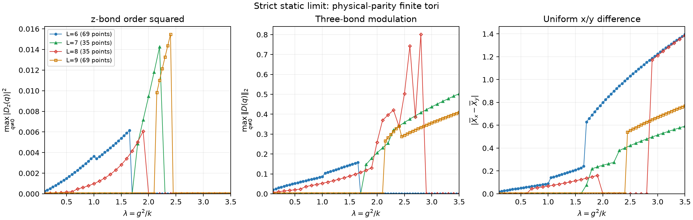
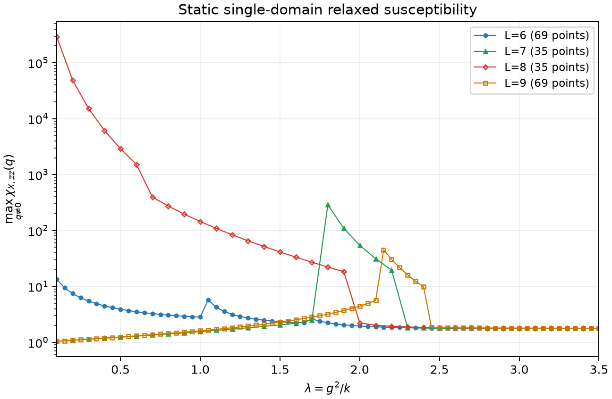

# 绝热极限：物理宇称代码与有限环面数据

## 新增：2026-11-10 的 Jz=0.6 数据

[J=(1,1,0.6)、L=3–10 数据入口](results/Jz0p6-20261110/README.md)：
lambda=0.1–3.0、间隔0.1，当前已验证238/240点，L10的lambda=0.1、0.2仍待高精度响应核查。
包含各尺寸CSV、完整验证字段、覆盖表、对比PNG及来源校验信息；
[离线作图](plot_Jz0p6.py)只读取发布表格，不启动计算。
此数据集独立保存；下文及历史冻结模型仍描述Jz=0.5批次。

## 历史：Jz=0.5 的 L6–L9 数据与冻结代码

整理：2026-11-02。这里发布已有、经过数值核验的有限环面静态结果；本次未运行新的扫描。
固定 J=(1,1,0.5)、k=1、g=sqrt(lambda)、Lx=Ly=L、shear=0、零通量、Wilson=(+,+)。
绝热极限取固定 k、g 下 m→∞，没有声子动能、投影时间或 Monte Carlo sweep。
有限方形尺寸 L 与矩形超胞/Bloch 参考的周期 N 不同；本目录不发布后者。

## 数据入口

| L | 点数 | lambda 范围 | 步长 | 简表 |
|---|---:|---|---|---|
| 6 | 69 | 0.1–3.5 | 0.05 | [L6.csv](results/L6.csv) |
| 7 | 35 | 0.1–3.5 | 0.1 | [L7.csv](results/L7.csv) |
| 8 | 35 | 0.1–3.5 | 0.1 | [L8.csv](results/L8.csv) |
| 9 | 69 | 0.1–3.5 | 0.05 | [L9.csv](results/L9.csv) |

共208点，保留各尺寸原有分辨率，没有插值。
[合并简表](results/summary.csv)为上述四表的合并；
[完整验证摘要表](results/validated-summary.csv)按原字节保存，包含额外的搜索、稳定性和验证字段。
完整多初值候选、全 q 响应矩阵及所有逐点构型不属于这次紧凑数据发布。





图中折线连接相邻采样点，包括分支切换，仅帮助阅读，不代表突变区有额外计算。
没有 Monte Carlo 统计误差；这不意味着不存在数值精度或优化搜索限制。

### 简表字段

令 D_mu(q)=sum_r exp(−iq·r)X_mu(r)/Nc，Nc=L²；使用原始 X，没有乘 g。

- `m2_z`：max_(q≠0)|D_z(q)|²，等于完整表的 `order_z_max_squared`。
- `order_z_max_nonzero`、`order_vector_max_nonzero`：非零 q 的 z 键幅度及三键向量范数最大值。
- `uniform_xy_difference`：|mean(Xx)−mean(Xy)|。非零 q 的 z 分量消失不等于所有键序消失。
- `chi_zz_max_nonzero`、`mixed_chi_max`：非零 q 的 zz 响应与三键响应矩阵最大本征值的最大值。
  chi_mu,nu(q)=F_mu H_X^−1 F_nu*/Nc，源为 −h sum fX；所有实键随场松弛，不减自由声子项。
- `order_peak_n1/n2`、`chi_peak_n1/n2`：各自最大值的动量索引，q=(n1/L,n2/L)；两类峰可不同。
- `energy_per_cell`、`gradient_max`、`hessian_minimum`：静态总能量/Nc、驻点残差和最小曲率。
- `required_code_parity`、`selected_code_parity`：物理要求与实际选定的代码 Fock 宇称。
- `chi_peak_mode_domain_response`：该模式是否有平移畴选择引起的零场非唯一性。
- `response_absolute_uncertainty`、`response_relative_target`、`response_precision_policy`：
  L7/L8 后续响应认证的数值误差界及策略。空白表示原记录没有该字段，不能解释成零误差。

L7/L8 的普通响应用绝对2e-5目标，软响应采用显式误差界下的相对1e-6目标。
因此 L8 某些软点的巨大 chi 不应被无误差地解读；原记录和误差预算见[验证说明](validation/README.md)。
chi 是稳定单畴的局部响应；发生简并畴切换时，不等于唯一有限的对称恢复零场极化率。
多初值和独立核验不证明全局最优，也不确定热力学临界点或所有 flux/Wilson 扇区的最低能。
静态单构型 m² 与有限频率 QMC 的 <|D|²> 也不相同。

## 代码入口与复现

```bash
python3 -m pip install -r limit/requirements.txt
export OPENBLAS_NUM_THREADS=1 OMP_NUM_THREADS=1 MKL_NUM_THREADS=1
export MPLCONFIGDIR=/tmp/susy-limit-matplotlib
python3 limit/plot_results.py
# 可选：改变作图范围，输出到新目录
python3 limit/plot_results.py --lambda-min 1 --lambda-max 3 --output-dir results/static-plots
```

离线作图仅依赖已发布 CSV，不读取本机历史目录或 HPC。

| 用途 | 代码 |
|---|---|
| 显式物理宇称、能量/梯度及独立正交搜索 | [physical_model.py](source/physical_model.py) |
| 全实键静态模型、优化与三键 Fourier 响应基础 | [static_limit_response.py](source/static_limit_response.py) |
| 解析固定宇称 Hessian、软响应高精度认证 | [accurate_response.py](accurate_response.py) |
| 原始批次搜索/交叉松弛/认证流程 | [workflow.py](source/workflow.py) |
| 独立 Fock、导数及物理扇区验证 | [validate_physics.py](source/validate_physics.py) |
| 固定共同背景曲率、动量辅助 | [static_vbs_response.py](source/static_vbs_response.py)、[predict_vbs_momenta.py](source/predict_vbs_momenta.py) |

这7个原始源文件均按冻结字节迁入；身份与原来源见 [PROVENANCE.json](PROVENANCE.json)。
`workflow.py` 依赖原任务的 plan、种子库和阶段产物；本次不把这些大任务目录当成便携运行入口。
`accurate_response.py --diagnose` 同样属于原任务诊断入口；独立使用其模型和认证函数即可。
旧 `kitaev_ssh/static_limit_response.py` 和 `static_vbs_response.py` 保留为兼容入口，执行此处原实现。

显式物理模型的最小使用方式，从仓库根目录运行：

```python
import sys
sys.path[:0] = ["limit", "limit/source"]
import numpy as np
from accurate_response import AccuratePhysicalStaticModel

model = AccuratePhysicalStaticModel(6, 2.4)  # 固定上述 J、k、几何和 Wilson
print(model.physical_rule)                  # L6 要求 +1，L7/L9 要求 −1，L8 要求 +1
energy, gradient = model.objective(np.zeros(model.nb))
```

新多初值搜索可调用 `source.static_limit_response` 的 `initial_states` 与模型 `relax`，
但初值数、随机种子、交叉松弛和认证都必须另行记录，不能把一次局部优化等同于本表完整搜索。
原批次冻结流程完整保留，物理参数没有被改写。

**宇称区别：** `PhysicalStaticModel` 显式按几何选择物理扇区；旧基础 CLI 的
`--parity trial` 仍表示历史自由真空扇区，不会自动变成 physical。尤其不能直接用它
重算 L6/L8 后宣称得到这里的物理结果。L7/L8 的准确响应使用独立解析适配器，未覆盖原基础实现。
更多尺寸分析见 [不同 L 与短时标度](../docs/FINITE_SIZE_AND_SHORT_TIME.md)。
