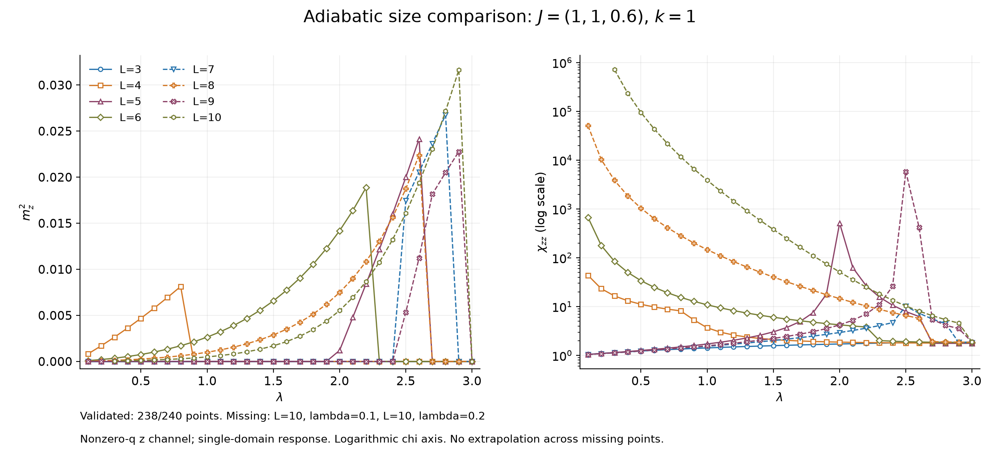
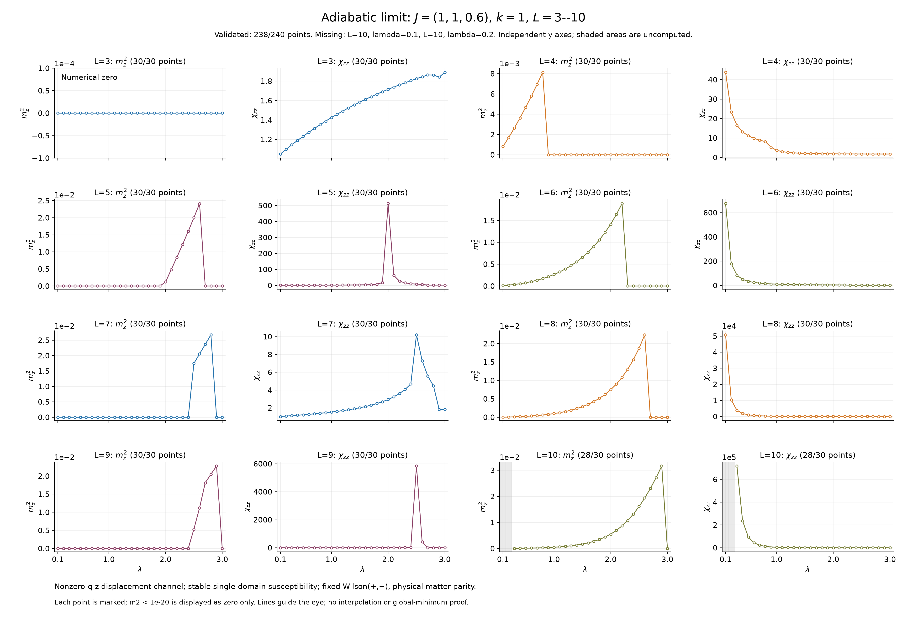

# J=(1,1,0.6)：L=3–10 绝热极限数据

2026-11-10 的已验证结果快照：**238/240点**。lambda=0.1–3.0、间隔0.1，每个L计划30点。
**L10的lambda=0.1、0.2仍待高精度单畴响应认证**；缺点不填零，不作插值或外推。

| L | 已验证点数 | 简表 |
|---|---:|---|
| 3 | 30 | [L3.csv](L3.csv) |
| 4 | 30 | [L4.csv](L4.csv) |
| 5 | 30 | [L5.csv](L5.csv) |
| 6 | 30 | [L6.csv](L6.csv) |
| 7 | 30 | [L7.csv](L7.csv) |
| 8 | 30 | [L8.csv](L8.csv) |
| 9 | 30 | [L9.csv](L9.csv) |
| 10 | 28 | [L10.csv](L10.csv) |

[合并简表](summary.csv) · [完整验证字段表](validated-summary.csv) · [240点覆盖表](coverage.csv) · [来源与参数](PROVENANCE.json) · [核查摘要](../../validation/Jz0p6-20261110/README.md)

## 参数和定义

J=(1,1,0.6)，k=1，g=sqrt(lambda)。square L×L环面、shear=0，固定零通量Wilson(+,+)，几何推导物理matter宇称。偶数L要求+1，奇数L要求−1；每个声子构型重新判断真空宇称，必要时加入最低准粒子的2*s_min占据修正，修正同步进入梯度与Hessian。

m2_z=max_(q!=0)|D_z(q)|²，D_z(q)=sum_r X_z(r)exp(-iqr)/L²。
chi_zz_max_nonzero=max_(q!=0) Re(Fz† H_X^-1 Fz)/L²，全部键允许随场松弛，是**稳定单畴响应**，不包含畴切换，不额外乘g²，也不扣除自由声子项。
动量索引分别给出m²和chi的峰，q=(n1/L,n2/L)，两者可以不同。

summary.csv使用m2_z列；validated-summary.csv保留原任务列名m2及其他x/y/三键向量m²、能量与验证残差。validated=True表示该行通过本任务核查；global_minimum_proven=False仍然成立。有限场比较残差不是统计误差条。

## 当前图



极化率叠加图采用对数纵轴，以保留小lambda软响应及有限lambda处的峰。



每个计算点均标记；各面板纵轴独立。m²<1e-20仅在图中显示为0，CSV保留原始数值。相邻采样点连线仅引导视线，分支切换区未额外加密。

## 离线重画

在仓库根目录运行：

```bash
python3 -m pip install -r limit/requirements.txt
python3 limit/plot_Jz0p6.py
# 可选：输出到新目录
python3 limit/plot_Jz0p6.py --output-dir /tmp/Jz06-plots
```

脚本只读取本目录CSV，不访问HPC、不启动新计算。原limit/source/和accurate_response.py的历史冻结实现仍保留其Jz=0.5默认；本次只发布新数据与离线作图，不改写历史源码或历史Jz=0.5表格。

结果是有限环面、固定规范扇区内多初值及两轮跨lambda交叉松弛找到的局部极小候选；未证明全局基态，不据此确定热力学相界。静态构型m²与有限频率QMC的系综<|D|²>不同。
