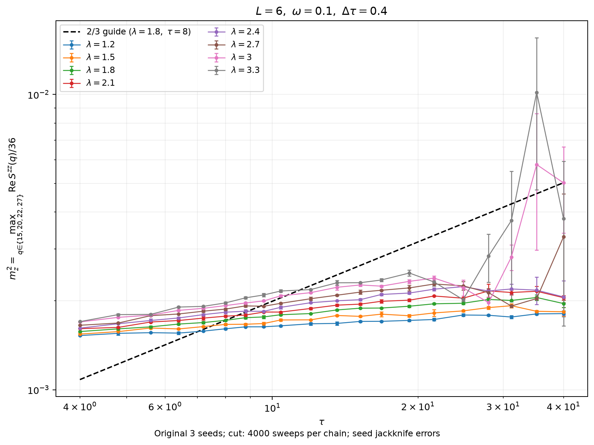

# 2026-10-30 序参量测量快照

这些图用于比较有限尺寸、有限投影时间下的观测量。数据均来自已有任务，
本次仅整理与离线复算。所有频率比较固定 J=(1,1,0.5)、k=1、m=1/ω²。
τ 是完整投影路径长度；每条链单独去除指定测量 sweep，随后合并原始复相位矩。

## L6、ω=0.1：动量搜索范围影响曲线

原 3 个 seed，λ=1.2/1.5/1.8/2.1/2.4/2.7/3/3.3，τ=4–40，dt=0.4，cut4000。
快照为 2026-10-30 UTC 11:36:16 汇总完成的数据，160 格、480 条链。
续算文件已包含祖先统计，原链只计一次；后来新增的 seed 没有纳入。

- [所有非零动量中取峰](L6_w0p1/order-squared-vs-tau.png)，定义 m²=max Re Szz(q)/36。
- [只取裸 Dirac 点差最近四个动量](L6_w0p1/m2-vs-tau-four-q-slope-2over3.png)，
  q={15,20,22,27}，即 (n1,n2)=(2,3)/(3,2)/(3,4)/(4,3)，q=6*n1+n2。
- [全 q 数值](L6_w0p1/summary.csv)、[四 q 数值](L6_w0p1/four-q-summary.csv)。



图中 2/3 虚线通过 λ=1.8、τ=8 的点，只是参考斜率；没有据此拟合或确认指数。
全 q 定义下，160 格中 152 格峰为 q=7 及其反向 q=35；长 τ 强耦合处出现
其他峰。因此，四 q 限制后的量与先前全 q 峰是不同的统计量。
λ=3.3、τ=35.2 的四 q 最大值 m²≈0.01016，seed jackknife 1SE≈0.00540，
误差大，删除一条 seed 后峰值动量可改变，不能视为已确立的有序波矢。

## L9、ω=1：仅小 τ 系列

λ=6/7/8，τ=2/2.4/3/4/6/8，dt=0.1，每链 cut5000。
快照 UTC 11:01:17 汇总完成，18 格、71 条有效链。
多数点 4 seed；λ=8、τ=8 的一条链因 numerical_failures=1 排除，仅 3 seed。
τ10/12 的24条链均不足5000 sweep，因此未画入。

[序参量 m_z](L9_w1/order-vs-tau.png) ·
[序参量平方](L9_w1/order-squared-vs-tau.png) · [数值](L9_w1/summary.csv)

τ8 使用 q pool/beta0.5，其余小 τ 使用固定 q=(5,4)/beta1；物理参数相同，
更新效率与可能的有限采样偏差仍需检查。不能把长 τ 端的上升自动解释为标度律。

## L6、λ=2：频率比较

[ω=0.1/0.2/0.3/0.5 的 m² 对比](L6_lambda2_omega_comparison/order-squared-comparison.png) ·
[数值](L6_lambda2_omega_comparison/summary.csv)

每条链 cut4000。ω=0.1 每点3seed，短 τ 使用 dt0.2，另有 τ12/dt0.4 点；
其他频率每点4seed、dt0.4、τ4–12。两端快照在 UTC04:33–04:38 汇总。
ω=0.1 历史任务 q/Gamma 关闭，其余启用固定非零 q 和多尺度 Gamma；
源程序来自不同冻结版本。未扣除随 ω 变化的自由声子背景。
该图不能单独分离时间步长、trial 边界、背景和充分平衡后的频率效应。

## 离线重现

从仓库根目录运行，需要 Python 3、NumPy 和 Matplotlib：

```bash
export MPLCONFIGDIR=/tmp/susy-matplotlib
python3 measurements/20261030/L6_w0p1/plot_all_q.py
python3 measurements/20261030/L6_w0p1/plot_four_q.py
python3 measurements/20261030/L9_w1/analyze_plot.py
python3 measurements/20261030/L6_lambda2_omega_comparison/analyze_plot.py
```

gzip JSON 保存各链截断后的复相位分子、共同分母、保留样本数、源文件路径及
读取摘要。每次 jackknife 删除整条独立 seed，再重新计算比值和允许 q 中的最大值。
图中1SE未包含投影、时间步长、有限尺寸和未热化偏差；这些聚合矩没有逐 sweep
信息，无法用于重新选择 cut 或计算链内自相关。

源码快照身份与各数据文件的 SHA256 见 [PROVENANCE.json](PROVENANCE.json)。
完整 checkpoint、可执行文件和运行库保留在 HPC，不包含于此数据发布。
